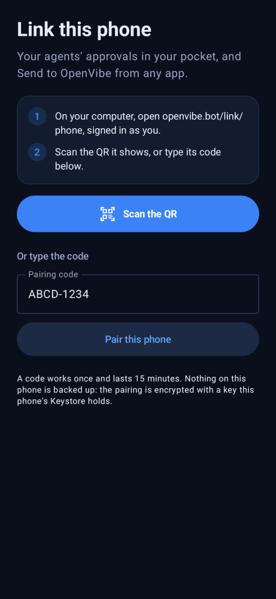
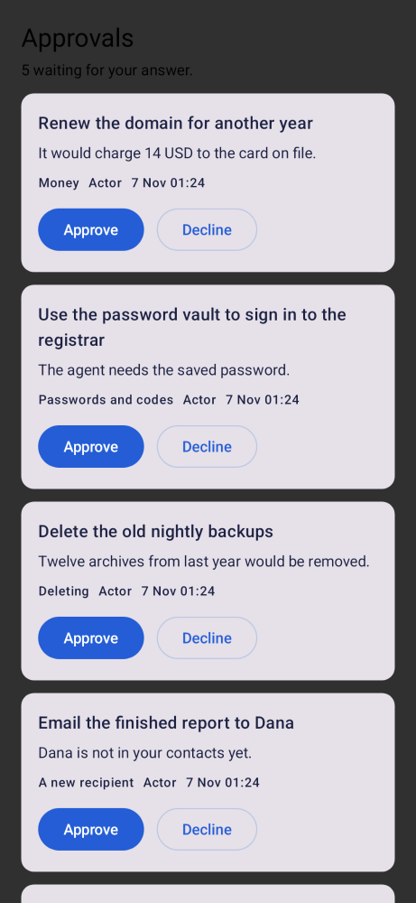
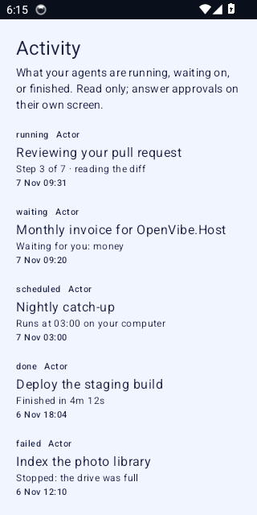
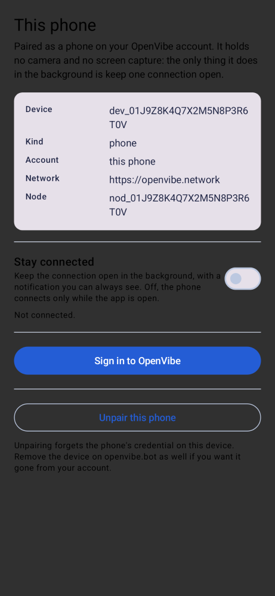

# Link on your phone (Android)

OpenVibe Link for Android puts your account in your pocket: **Approvals** for what your agents asked while you were
away, **Activity** (the Dock's timeline), your phone as a **device** on your account, and **Send to OpenVibe** from any
app's share sheet.

This is v0 of the phone build (plan 2026-11-07 §13.2). It has no phone automation: no AccessibilityService, no
MediaProjection, no reading the screen and no tapping for anyone. The only thing it does in the background is hold one
outbound connection, and only when you turn **Stay connected** on.

## Install

1. Download `openvibe-link-v<version>.apk` from the repository's Releases.
2. On the phone, allow installing from that source when Android asks.
3. Open **OpenVibe Link**.

The APK is signed with the project's release key. A debug APK (`app-debug.apk`) is attached to CI runs and can be
installed the same way; Android allows it beside nothing else (the package is `network.openvibe.link`).

## Pair the phone

1. On a computer signed in as you, open **https://openvibe.bot/link/phone**.
2. The page shows a code and a QR. The code works once and lasts 15 minutes.
3. In the app, type the code or tap **Scan the QR instead**.

Pairing is the Node's own: the code is redeemed on OpenVibe.Network, the phone gets a node credential, and it is bound
on OpenVibe.Bot as a device of kind **phone**. The credential never leaves the phone in the clear: it is encrypted with
a key the Android Keystore holds, and nothing on the phone is backed up.

## The four screens

- **Pair**: the code field and the scanner. A QR encodes `openvibe-link://pair?code=…&pairing=…`, which opens the app
  with the code filled in even from the phone's camera app. The app talks only to **https://openvibe.network** (a build
  constant, never a field): a QR or link that names another server is refused and says which.
- **Approvals**: Actor's pending approvals for you. Approve or decline. **Money, passwords, deletions and a send to a
  new recipient ask for a fingerprint, a face or the device credential first** (BIOMETRIC_STRONG, with the device
  credential behind it on Android 11+), and the answer is only sent after it succeeds.
- **Activity**: the Dock's timeline, read-only.
- **This phone**: what the phone is paired as, **Stay connected** (a foreground service with a notification you can
  always see and stop), sign-in, and **Unpair**.

Approvals and Activity need your OpenVibe account as well as the pairing: tap **Sign in to OpenVibe**. That is a public
OAuth client (`link`) with PKCE S256 and no secret in the APK. The sign-in returns to
`https://openvibe.network/link/auth`, an **Android App Link** claimed for this package (Network publishes
`/.well-known/assetlinks.json` with the release certificate's SHA-256), so no other app can answer the redirect; the
chooser always shows what the app does, and its token is your own session with your non-staff role.

Until the owner's release key exists (`LINK_ANDROID_CERT_SHA256` on Network), Android verifies no app for that link and
the client gets Network's read-only Dock token instead of a session: the app still pairs, and signing in is what waits
for the key. A debug build returns on `openvibe-link://auth` and always gets the Dock token.

The tokens and the pairing are AES-GCM-sealed with a key the Android Keystore makes and never exports, nothing is
logged, and the app's data is excluded from Android backups.

### The screens

Rendered from the Composables (Pixel 5, light theme; a dark phone uses Vibe's dark tokens):

| Pair | Approvals |
|---|---|
|  |  |

| Activity | This phone |
|---|---|
|  |  |

The CI's second job takes the same four on an emulator (non-blocking). The app also has a debug-only `PreviewActivity`
that draws one screen with sample data without an account — what these pictures come from:
`adb shell am start -n network.openvibe.link/.PreviewActivity --es screen approvals`.

## Send to OpenVibe

Share a file or a photo from any app and pick **Send to OpenVibe**. The sheet asks first — **Send** starts the upload,
**Cancel** sends nothing. It goes to your **Download** drive
(openvibe.download) through the drive's own upload (the same three steps the web page makes: start, parts, complete),
with progress in a notification. Nothing is re-encoded. A shared text becomes a small `.txt` named after its first
line.

## Build it

The app is in `android/`; it shares the Node's Go core through `gomobile bind`, so pairing, token refresh and
reconnects are the same code the desktop Node runs. A debug build may be pointed at another server with
`./gradlew :app:assembleDebug -Pnetwork.url=https://staging.example`; that build shows a **Debug server** banner on every
screen, and a release build always carries the official one.

```sh
# 1. Generate the design system from the pinned openvibe-shared release (never hand-edit these files).
sh android/scripts/gen-design.sh

# 2. Bind the Go core into android/app/libs/core.aar (needs an Android NDK).
ANDROID_HOME=~/Android/Sdk sh android/scripts/build-core.sh

# 3. Build and test.
gradle -p android :app:testDebugUnitTest
gradle -p android :app:assembleDebug
```

Versions are pinned: Gradle 8.11.1 (`android/gradle/wrapper/gradle-wrapper.properties` and the CI), Android Gradle
Plugin 8.7.3 and Kotlin 2.0.21 (`android/build.gradle.kts`), gomobile and the openvibe-shared release in the two
scripts. `android/design-version.txt` names the shared release; the CI refuses a stale generated theme.

CI (`.github/workflows/android.yml`) builds the core, runs the unit tests, builds the debug APK and attaches a signed
release APK on a tag when the repository has the signing key (`ANDROID_KEYSTORE_BASE64`, `ANDROID_KEYSTORE_PASSWORD`,
`ANDROID_KEY_ALIAS`, `ANDROID_KEY_PASSWORD`). With no key it says so and skips the signed build; it never generates one.
A second, non-blocking job takes screenshots on an emulator.

## Tests

- `android/app/src/test`: the approval categories that need biometrics (`ApprovalRulesTest`), the share-intent
  parsing (`ShareIntentsTest`), the pairing links and PKCE (`PairLinksTest`).
- `go test ./mobile`: pairing against a fake Network and Bot.
- The rest of the Go tests are unchanged.

## What v0 does not do

- No phone automation (plan §13.2's opt-in Accessibility Service and MediaProjection are a later, separate build).
- No Google Play, no Firebase, no third-party account.
- No iOS yet.
- Activity is read-only; answering happens in Approvals.
